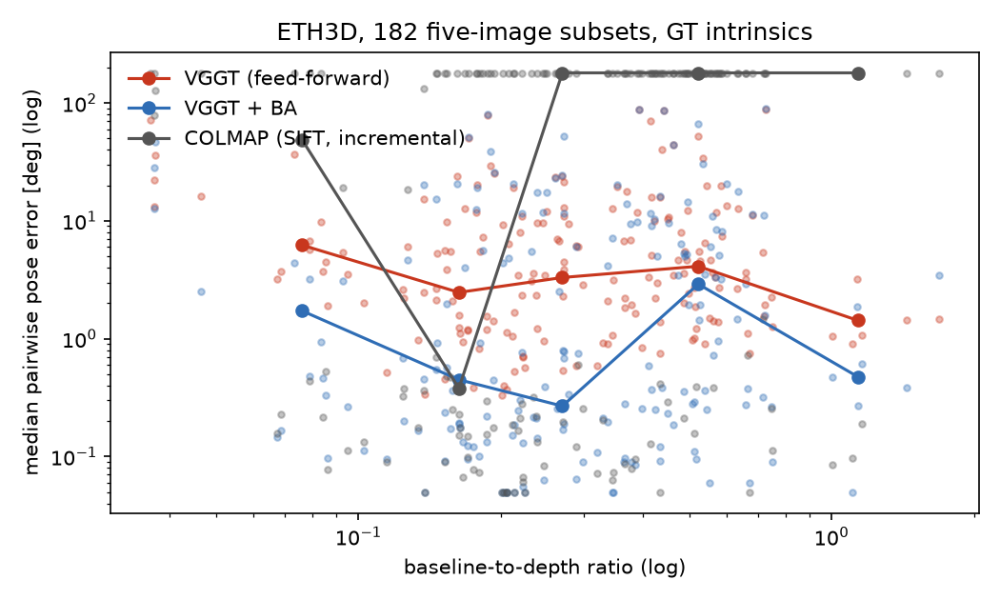

# VGGT pilot: pose accuracy vs. baseline on ETH3D

Just a small project after reading the VGGT Paper, it got me thinking:

how does a frozen geometry foundation model (VGGT-1B) compare with
classical SfM, and with itself refined by bundle adjustment, as the
baseline-to-depth ratio of a small image set shrinks?

## Setup

- Data: ETH3D high-res multi-view training scenes `pipes`, `office`,
  `terrace`, `courtyard` (undistorted DSLR images + ground-truth poses).
- Subsets: 5 images each. For every image, its 4 nearest cameras (small
  baseline) and 4 random cameras (larger baseline): 182 subsets, with
  baseline-to-depth ratios from about 0.04 to 1.7.
- Methods (ground-truth intrinsics, kept fixed, for the classical ones):
  - **VGGT**: feed-forward poses, no refinement.
  - **VGGT + BA**: VGGT poses as initialization, points triangulated from
    SIFT matches, then bundle adjustment, coarse to fine (triangulation
    thresholds 200 → 40 → 4 px, robust Cauchy loss in the first two rounds).
    With COLMAP's default 4 px thresholds from the start, VGGT's few-degree
    errors left only ~8 points per subset and BA could not do anything.
  - **COLMAP**: SIFT (max 1600 px), exhaustive matching, incremental SfM.
- Metric: for every image pair, max(relative-rotation error,
  translation-direction error) in degrees; AUC@5 and AUC@10 as in
  GLOMAP/VGGT; an image a method fails to register counts as 180 degrees.

## Run

```bash
git clone --depth 1 https://github.com/facebookresearch/vggt.git

# ETH3D scenes (undistorted DSLR images incl. ground-truth calibration)
mkdir -p data
for s in pipes office terrace courtyard; do
  curl -L -o data/$s.7z https://www.eth3d.net/data/${s}_dslr_undistorted.7z
done
# extract each archive into data/ (e.g. `7z x data/<scene>.7z -odata`)

uv venv --python 3.11 .venv
uv pip install --python .venv/bin/python torch torchvision "numpy<2" pillow \
  huggingface_hub einops safetensors scipy opencv-python matplotlib tqdm \
  pycolmap py7zr -e ./vggt          # vggt = git clone of facebookresearch/vggt
cd scripts
../.venv/bin/python make_subsets.py
PYTORCH_ENABLE_MPS_FALLBACK=1 ../.venv/bin/python run_vggt.py
../.venv/bin/python run_colmap.py
../.venv/bin/python evaluate.py     # -> results/summary.csv, results/pose_error_vs_ratio.png
```

torch and pycolmap each bundle OpenMP and crash in one process, so VGGT and
COLMAP run as separate scripts. 
Runs on an Apple M5 (MPS) (My current personal device), about 5 s per
subset for VGGT.

## Results

AUC@5° (%) of pairwise pose error, by baseline-to-depth ratio. "COLMAP
fails" = share of subsets where COLMAP could not register all 5 images.

| Baseline/depth | Subsets | VGGT | VGGT + BA | COLMAP | COLMAP fails |
|---|---|---|---|---|---|
| < 0.1   | 16  | 20.2 | 58.7 | 38.1 | 62% |
| 0.1–0.2 | 39  | 42.3 | 69.0 | 58.2 | 54% |
| 0.2–0.4 | 60  | 41.5 | 65.7 | 45.8 | 67% |
| 0.4–0.8 | 60  | 35.5 | 51.7 | 24.2 | 95% |
| > 0.8   | 7   | 59.9 | 76.8 | 48.3 | 71% |
| **All** | 182 | 38.4 | 61.5 | 40.7 | 73% |



- VGGT is least accurate at the lowest parallax. There its error is mostly
  in the translation direction (median 6.9°), while rotation stays good
  (0.5°).
- Bundle adjustment from VGGT's poses helps in every bin, most at the lowest
  parallax (AUC@5 20 → 59).
- Yet VGGT alone was more accurate than VGGT + BA in about 22% of image
  pairs (22.3% for rotation, 22.0% for translation direction; between 14%
  and 31% depending on the bin), so a prior still has some room to help.
  These cases come mostly from subsets where few points could be
  triangulated, not from low parallax: VGGT wins 31% of pairs in the third
  of subsets with the fewest BA points (< 746), but only 10% in the third
  with the most (≥ 2467), and 28% in the "random" vs. 14% in the "near"
  subsets.
- COLMAP is very precise when it works but fails on most of these small,
  low-overlap sets. Raising SIFT resolution to 3200 px did not change that
  (checked on 12 failed subsets).

`results/vggt/` and `results/colmap/*/poses.npz` hold the estimated poses,
so `evaluate.py` can be rerun without recomputing (the ETH3D ground truth is
still needed).

## Limitations

Just a Small study with 4 scenes, 5-image subsets, one random seed, ground-truth
intrinsics for the classical methods but predicted intrinsics for VGGT.

## Acknowledgements

- [VGGT](https://github.com/facebookresearch/vggt) (Wang et al., CVPR 2025),
  used as is under the VGGT License. Its code and weights are not part of
  this repository.
- [ETH3D](https://www.eth3d.net) (Schöps et al., CVPR 2017) for the images
  and ground truth. The data is not redistributed here.
- [COLMAP / pycolmap](https://colmap.github.io) for features, matching,
  SfM and bundle adjustment.

## License

The scripts in this repository are MIT-licensed (see `LICENSE`). VGGT and
ETH3D keep their own licenses.
